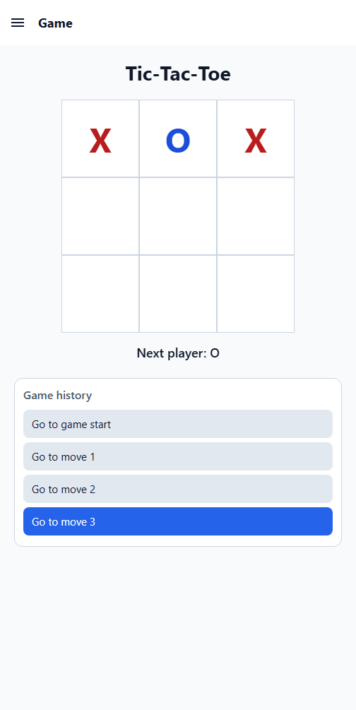
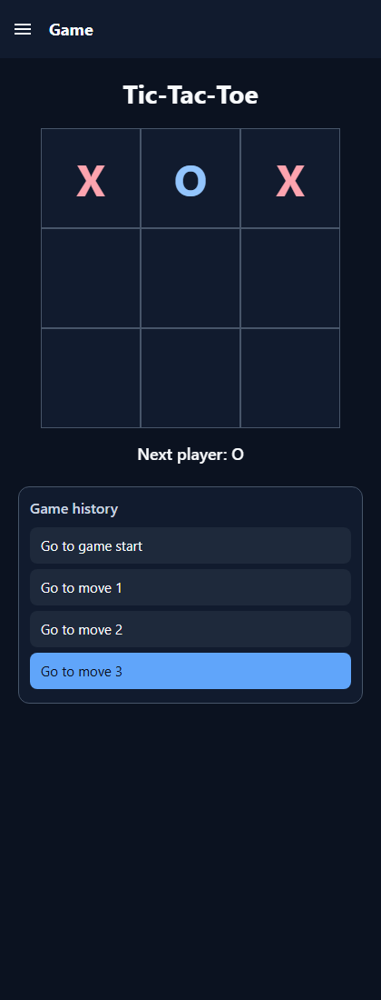

# Tic-Tac-Toe

Mobile Development CS 3624

## Overview

A React Native Tic-Tac-Toe app built with Expo and Expo Router. Play a complete
game, review earlier moves, and switch between light and dark themes. The Game,
Settings, and About screens are available from the navigation drawer.

## Features

- Play as X and O, with win and draw detection.
- Restart a game at any time; a draw automatically restarts after its result
  is shown.
- Jump to any previous move; playing from an earlier move starts a new branch
  of game history.
- Open the Game, Settings, and About screens from the drawer or by swiping in
  from the edge.
- Switch between light and dark themes; the selection applies across screens.
- View the app name and version from `app.json` on the About screen.

## Screenshots

### Game — Light theme



### Game — Dark theme



## Run the App

```bash
npx expo start
```

Open the project in Expo Go, or press `w` in the terminal to use the web
version.
